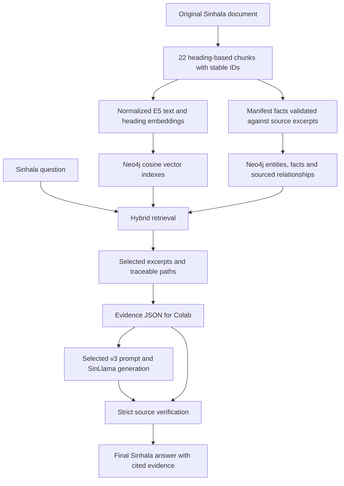

# Sigiriya Hybrid GraphRAG with SinLlama

Answer Sinhala questions about Sigiriya from the original tourism document. The local pipeline uses multilingual E5 and Neo4j to retrieve evidence. Colab uses 4-bit SinLlama to generate answers from selected excerpts and retains the local extractive answer when strict source verification rejects a completion.



## Project layout

```text
Sigiriya-Hybrid-GraphRAG/
├── .env.example
├── requirements.txt
├── data/raw/                         Original Sinhala documents
├── original_group_work/
│   ├── setup_sigiriya_local.py        Chunk, embed and build the graph
│   ├── Sigiriya_GraphRAG_Stage2.py     Graph creation and validation
│   ├── Sigiriya_KG_Expansion_Manifest.json
│   └── Sigiriya_GraphRAG_Stage2_Offline_Tests.py
├── src/                              Retrieval, evidence, prompts, generation, verification
├── scripts/                          Export, Colab packaging, reporting, offline replay
├── notebooks/sinllama_colab/
│   └── Sigiriya_SinLlama_Focused_Comparison_v3.ipynb
├── tests/                            Offline regressions
└── results/
    ├── generation/                   Saved evidence packet and reference outputs
    ├── retrieval/                    Annotated retrieval results
    └── sinllama_focused_comparison_v3/ T4 report, review CSV and v2 replay
```

The tree shows the active workflow. The Stage 2 builder and manifest stay together because the original graph commands, offline fixtures and current diagnostics resolve paths there. Earlier executed notebooks, annotated retrieval fixtures and historical output reports are retained for review. The numbered comparison helpers also supply the v3 generator, topic mapping, verification and runtime packaging.

## 1. Build the database

Run these PowerShell commands from `Sigiriya-Hybrid-GraphRAG`. Use Python 3.13 and a dedicated empty Neo4j database with vector index support.

```powershell
python -m venv .venv
.\.venv\Scripts\python.exe -m pip install -r requirements.txt

$env:NEO4J_URI = "bolt://127.0.0.1:7687"
$env:NEO4J_USERNAME = "neo4j"
$env:NEO4J_DATABASE = "neo4j"
$credential = Get-Credential -UserName $env:NEO4J_USERNAME -Message "Dedicated Sigiriya Neo4j database"
$env:NEO4J_PASSWORD = $credential.GetNetworkCredential().Password

.\.venv\Scripts\python.exe -B original_group_work/Sigiriya_GraphRAG_Stage2.py --offline-check
.\.venv\Scripts\python.exe -B original_group_work/setup_sigiriya_local.py
.\.venv\Scripts\python.exe -B original_group_work/Sigiriya_GraphRAG_Stage2.py --inspect
```

`.env.example` lists the environment variables. The scripts read them from the shell. Point the URI and database at the dedicated instance before running setup. Setup checks the target node count before writing and stops on a populated database. If setup stops after inserting chunks, use a fresh empty database for a full rerun.

The loader splits `data/raw/SIGIRIYA – TOURISM INFORMATIONSinhalatxt.txt` at its numbered headings and assigns `sigiriya_001` through `sigiriya_022`. The first run downloads `intfloat/multilingual-e5-base`. Setup encodes heading and body independently with the `passage: ` prefix, normalizes both 768-dimensional vectors, and waits for both cosine indexes to come online. Stage 2 creates uniqueness constraints and stores 49 entities and 54 facts with source links covering all 22 chunks.

## 2. Retrieve and export evidence locally

```powershell
$env:PYTHONIOENCODING = "utf-8"
.\.venv\Scripts\python.exe -B -m src.chatbot "සීගිරි බිතුසිතුවම් ගැන කියන්න."
.\.venv\Scripts\python.exe -B -m scripts.sinllama_handoff --output results/local_export
```

For custom questions, save a UTF-8 file named `questions.txt` with one Sinhala question per line and run:

```powershell
.\.venv\Scripts\python.exe -B -m scripts.sinllama_handoff --questions questions.txt --output results/local_export
```

Retrieval embeds each question with the `query: ` prefix, searches text and heading indexes, and fuses their rankings. It identifies graph anchors and checks relationship-aware one-hop and two-hop paths. The evidence selector picks source excerpts and traces them back to stable chunk IDs. The JSON export includes the selected evidence, eligible graph paths, subquestions and extractive answers. Retrieval uses the locally cached E5 model.

## 3. Generate and verify answers in Colab

Build a focused v3 runtime ZIP from the repository. This command works without Neo4j. Choose a new output directory if the ZIP already exists.

```powershell
.\.venv\Scripts\python.exe -B -m scripts.sinllama_focused_comparison_v3 bundle --output results/colab_runtime
```

1. Open [Sigiriya_SinLlama_Focused_Comparison_v3.ipynb](notebooks/sinllama_colab/Sigiriya_SinLlama_Focused_Comparison_v3.ipynb) in Colab and select a T4 GPU runtime.
2. Run the installation and upload cells. Upload `results/colab_runtime/sigiriya_sinllama_focused_runtime_v3.zip` for the saved packet. For a fresh export, include `results/local_export/sigiriya_sinllama_evidence.json` in the same upload.
3. Run the question listing cell. Set `selection` to map the desired evidence question IDs to profiles and rerun that cell if you edit it.
4. Run the inference and download cells. The notebook displays the raw model completion, strict verification decision, final answer, answer origin and source excerpts for each question, with separate topic decisions for decomposed questions.

The notebook loads `SAWithanage/SinLlama-Llama-3-8B-Merged` at revision `6c4f36c2a4dc71cf8258e3586daa3a51447b7088` with the v3 4-bit configuration. It reuses v3 prompt rendering, decoding, stopping, and cleanup. Strict verification requires complete, ordered copies of the selected excerpts. Rejected completions use the source-based fallback.

| Saved evidence ID | Profile | Recorded T4 result |
|---|---|---|
| `factual` | `R-Q01`, Sinhala system-grounded prompt | Accepted by strict verification |
| `mechanism` | `R-Q05`, legacy RAG prompt | Accepted by strict verification |
| `multi_topic` | A uses the decomposed legacy prompt. B uses the focused Sinhala prompt. C uses B with rendered source IDs and section numbers removed. | Both topics used fallback under all three profiles |

The default notebook selection runs the two verified controls. Choose A, B, or C explicitly to run the saved multi-topic question. For fresh evidence, A–C require the complete ordered topic mapping exported by the evidence selector. The saved human-review fields are blank, so there is no recorded preferred arm for Q03. See the [T4 GPU report](results/sinllama_focused_comparison_v3/sinllama_focused_comparison_v3_gpu.json) and [review sheet](results/sinllama_focused_comparison_v3/sinllama_focused_comparison_v3_gpu_human_review.csv).

## Offline checks and limitations

```powershell
python -B -m unittest discover -s tests
python -B original_group_work/Sigiriya_GraphRAG_Stage2_Offline_Tests.py
python -B -m scripts.evaluate_retrieval --validate-only
```

The corpus covers Sigiriya and cannot answer live tourism questions. Strict verification can reject paraphrases, incomplete answers and completions with unsupported content. The saved T4 report is a reference for the frozen packet. A live run depends on Colab runtime availability, model access and inference reproducibility. Fresh database provisioning and a fresh T4 run are integration checks separate from the offline suite.
